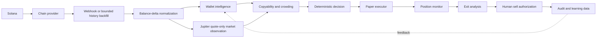

# Architecture

The system is a TypeScript monorepo with a Fastify API, Next.js command-center dashboard, domain-focused packages, PostgreSQL durable state, and Redis reserved for queue/cache coordination. Provider dependencies point inward through interfaces; strategy code does not depend on Helius, OpenRouter, or a future swap vendor.

## Boundaries

- `packages/core` owns balance-delta normalization, conservative action classification, bounded backfill orchestration, copyability/crowding evaluation, deterministic scoring, central money limits, paper position creation, and sell-state rules.
- `packages/providers` owns standard Solana RPC, optional Helius history fallback/webhook parsing, quote-only Jupiter market data, execution/notification interfaces, the paper provider, and optional OpenRouter calls.
- `packages/database` owns Drizzle schema, generated migrations, PostgreSQL persistence, and a named test-only in-memory store.
- `packages/config` validates environment configuration and rejects `LIVE` before service startup.
- `apps/api` validates HTTP input and delegates business logic to services.
- `apps/dashboard` renders API truth and explicit unknown/empty states. It does not calculate authoritative scores.

## Event and idempotency model

Transaction signatures are primary keys. Signals are unique by source transaction, wallet, and mint. A paper position is unique by signal. Position event idempotency keys are unique. Helius may retry webhook deliveries; a retry receives a successful `202` response and is counted as a duplicate without creating a second transaction.

The webhook parser preserves provider JSON and never infers swaps from marketing descriptions. Historical ingestion discovers bounded signatures, fetches `jsonParsed` transactions with `maxSupportedTransactionVersion: 0`, and derives wallet-owned SOL/SPL balance deltas. Multiple token accounts for one owner/mint are aggregated while account evidence remains attached. Failed, one-sided, incomplete, and multi-asset flows are classified conservatively rather than forced into buys.

## Execution and sell control

`ExecutionProvider` retains separate quote/build/execute operations for future reviewed implementations. The installed Jupiter component is only a market-data provider: it sends `GET /swap/v2/order` without `taker` and rejects transaction-bearing responses. `PaperExecutionService` can use a fresh quote's expected output as a simulated fill basis, records quote age, and does not label that quote as a real executable fill.

There is no signer, transaction builder, broadcaster, or live executor. Buy approval and sell authorization are deliberately asymmetric: future approved buys may be autonomous only after a separate review, while a live sell must have a recorded user authorization.

## AI isolation

OpenRouter requests pass through a serialized in-process queue, a conservative 50-request daily ceiling, bounded attempts, an 8-second default timeout, structured output validation, and an in-process prompt cache. With no key, the provider returns a typed disabled result. Nothing in ingestion, scoring, or immediate decisions calls the AI provider.
